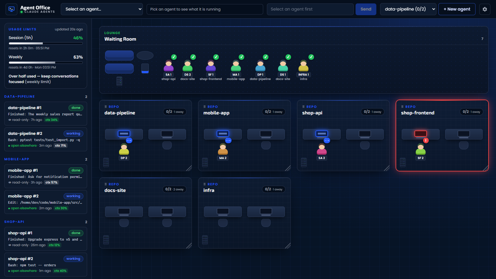

# Agent Office

**A local control room for your Claude Code agents.**

Agent Office shows every Claude Code session on your machine as people working in an office: one room per project, a desk per busy agent, a waiting room for idle ones. See what each agent is doing, how much usage you have left, and step in to talk to any of them, all from one browser tab. No login, no database, nothing leaves your computer.



## Features

- **Zero setup monitoring.** Reads Claude Code's own session files (`~/.claude/projects`, `~/.claude/sessions`), so recent sessions appear right away and update live.
- **Needs-input alerts.** A room turns red when an agent waits for a permission or an answer.
- **Live event log** per agent: your prompts, Claude's replies, every tool call.
- **Usage limits.** 5-hour and weekly limits with reset times, plus context % per agent.
- **Real terminals in the page** (xterm.js + node-pty): start agents, type, approve permissions, run slash commands.
- **Take over** a session started in a normal terminal, with its full history.
- **Agents survive restarts.** Each runs in its own detached host process; the server reconnects on start.
- **Guardrails.** Max agents per project (default 2), and a confirmation before starting one when usage is above 80%.
- **Your layout.** Drag and resize rooms, hide projects; saved in the browser.

## Quick start

Requires Node 20+ and `claude` on your PATH. Works on Windows, macOS and Linux.

```bash
npm install
npm run dev          # API on :4317, UI on :5173
```

Open http://127.0.0.1:5173. Optional extras:

```bash
npm run install-statusline   # feeds usage limits + context % to the app
npm run install-hooks        # extra hook events (not required for alerts)
```

Single port: `npm run build && npm start`, then open http://127.0.0.1:4317.

## Configuration

Optional. Copy `agent-office.config.example.json` to `agent-office.config.json`:

| key | meaning |
| --- | --- |
| `repos` | Pin projects: `{ "name", "path" }`. Others are discovered from sessions. |
| `maxAgentsPerRepo` | Agents the app runs at once per project (default `2`). |
| `importDays` | Import sessions active in the last N days (default `3`). |
| `claudeCommand` | Command for new agents, e.g. `"claude --model opus"`. |
| `runner` | `"auto"`, `"pty"` or `"tmux"`. |
| `port` | API port (default `4317`, or `AGENT_OFFICE_PORT`). |

## How it works

```
~/.claude/projects/*.jsonl ─┐
~/.claude/sessions/*.json ──┼─▶ Agent Office server (:4317) ──ws──▶ React UI (:5173)
status line / hooks ────────┘    in-memory state, agent hosts        office · log · terminal
```

- `src/server`: Express + ws, transcript and live-session watchers, terminal runners
- `src/client`: React UI
- `host/agent-host.mjs`: one detached process per agent, owns its terminal
- `hooks/`: status line and optional hook scripts

## Security

There is no login: it's meant for **your machine only**. The server listens on `127.0.0.1` and refuses requests whose `Host` or `Origin` isn't loopback, so websites can't reach it. **Never expose it** with a public server, tunnel or port forward: anyone who reaches it can type into your Claude sessions.

## License

MIT, see [LICENSE](LICENSE).
